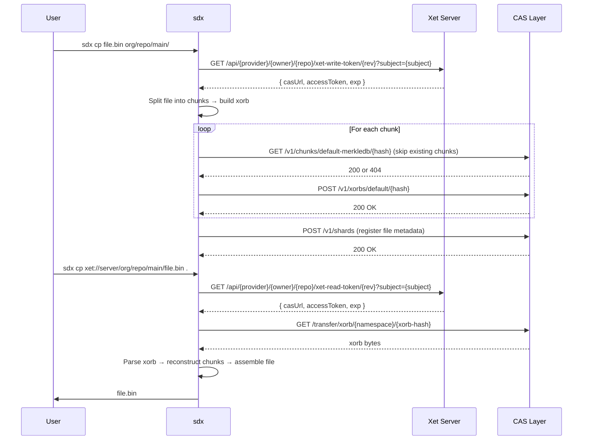

# Xet-Native File Management CLI

> **Status:** implemented.
> The `sdx` CLI described here ships with the `shardline` binary and provides native
> file transfer against any Xet-protocol server, including Shardline itself.

The shardline server implements the Xet CAS protocol for chunk-level deduplicated object
storage. The Hugging Face maintained `git-xet` (huggingface/xet-core) provides a Git LFS
custom transfer agent that works with any server supporting the Xet protocol, including
shardline. `sdx` is the standalone CLI for uploading and downloading files outside of a
Git workflow.

`sdx` is a file-transfer entrypoint that provides native file management against any
Xet-compatible server, including shardline itself.

## Scope

- `sdx cp` / `sdx sync` / `sdx ls` / `sdx rm` / `sdx cat` / `sdx info` / `sdx branch`
  provide a lightweight `cp`/`sync`/`ls`/`rm` interface for file transfer over the Xet
  CAS protocol.
- It targets any Xet-protocol server — not only shardline, but any server that
  implements the Xet read-token, write-token, and xorb-transfer endpoints.
- It reuses shardline's existing xorb chunking, CAS storage, and reconstruction logic as
  a client library rather than duplicating protocol work.
- It authenticates through the same provider-based token model: API key or bearer token
  to the server endpoint → scoped CAS token → content-addressed xorb transfer.
- It supports recursive directory upload, filtered download, incremental sync, and
  streaming large files.
- It ships as a single `shardline` binary — `sdx` is a symlink that invokes the same
  binary, which detects `argv[0]` and routes to the `xet` command lane automatically.

## Retrying interrupted uploads

Retry the same upload after a disconnect or server restart. Native Xorb and
shard uploads reuse unfinished attempts. If recovery has already marked an
attempt failed, the retry starts a new tracked attempt and preserves the old
failure record. No manual database cleanup is needed for this case.

Retries still verify content and repository authorization. They do not clear
unresolved remote deletes or overwrite a conflicting content identity. A failed
response alone does not establish whether an upload committed.

Different clients may encode the same Xorb content with different compression.
Shardline keeps the first stored container and its offsets. A differently encoded
retry succeeds only after its content and the complete retained container verify
against the same ordered chunk identities and lengths. It does not rewrite existing
containers or change how previously uploaded data is read.

## Streaming shard registration

`POST /v2/shards` accepts the same serialized shard and Write token as
`POST /v1/shards`. It returns newline-delimited JSON with a terminal `result`
after verified publication, or a sanitized terminal `error` on failure. Read the
response to completion: HTTP 200 starts the stream and does not mean the shard
committed. The existing version-one and unversioned routes remain available.

The stream starts with a validation event and repeats it every five seconds
while registration is pending. Its counters stay at zero when no finer-grained
progress is available; they are not a completed-work estimate. Write ownership
and bounded admission remain attached to publication. Disconnecting cancels the
operation without a detached worker; retry through the normal recovery path if
the final result was lost.

When admission is full, a new registration receives HTTP 503 with `Retry-After`
instead of starting another verification. A PostgreSQL/MinIO HTTP test holds a
source read across two validation events, checks this rejection, and verifies
that no file record appears before storage is released. It also checks that a
disconnected registration can retry safely. This qualifies that stalled-read
case, rather than sustained saturation across multiple hosts.

The stock `hf_xet` 1.6.0 and 1.7.0 Hub model/dataset workflows pass with both local storage
and disposable PostgreSQL/MinIO. Separate tests cover terminal errors,
authentication, cross-node PostgreSQL visibility, session loss and lock release
when a response is dropped. These checks do not establish the entire upstream
client/version compatibility matrix.

With `huggingface_hub` 1.25.1, both tested Xet versions also pass 512 MiB
SIGKILL/retry transfers and 1 GiB upload/download memory-bound checks on local
storage and PostgreSQL/MinIO. These are specific executed workflows, not a claim
that every optional upstream endpoint or deployment configuration is supported.

For large-file qualification, run the explicit Linux tests with stock `hf` and
`hf_xet` installed on `PATH`:

```bash
cargo test --manifest-path e2e/Cargo.toml --test native_huggingface_cli_e2e \
  native_huggingface_one_gib_upload_and_download_remain_bounded -- --ignored --nocapture
cargo test --manifest-path e2e/Cargo.toml --test native_huggingface_cli_e2e \
  native_huggingface_one_gib_with_postgres_and_minio -- --ignored --nocapture
```

These require Docker for PostgreSQL/MinIO and fail if prerequisites are missing.
They generate 1 GiB of incompressible content, require native Xorb/shard ingestion,
compare a cold-cache stock-client download byte-for-byte, then verify two
concurrent slow ordinary HTTP downloads against the file's SHA-256. Linux peak
RSS covers the server/test process, excluding the stock client and backend
services. Each test requires the process peak to stay below 384 MiB. This bounds
the tested workload; sustained saturation still requires separate qualification.
Run each command separately so other tests do not contaminate process-wide RSS.

The same large-file and two-reader checks pass with Hub 1.25.1 / hf_xet 1.5.2
on local storage and PostgreSQL/MinIO. Process I/O counters include more than
scratch writes and do not establish reduced device wear or a throughput gain.

The earlier single-client local run with Hub 1.25.1 / hf_xet 1.6.0 peaked at 109,636 KiB. The
PostgreSQL/MinIO run peaked at 240,460 KiB after large native bodies switched
to bounded file-backed staging; earlier in-memory staging runs reached
734,364–866,844 KiB. These are single-client observations, not cluster memory
or throughput guarantees. File-backed staging trades heap use for temporary
storage writes and uses the existing conditional multipart upload path on S3.
For privately owned upload staging, footerless normalization verifies the payload
and appends its footer in place, avoiding a second payload copy. The public
file-upload API preserves caller-owned input and still uses a separate normalized
temporary container when needed. Provision scratch capacity for concurrent uploads;
temporary storage is not a substitute for acknowledged durable objects.

Shard registration verifies containers in logical file order and reuses each
open source while computing the file's SHA-256. It keeps one materialized
container at a time, so a multi-container file does not require retaining its
whole contents locally. Revisiting a previously released container can require
another read. Complete source verification, selected-chunk checks and client
CAS metadata checks still finish before publication. This reduces repeated
verification reads; native uploads still retain their legacy decoded chunk
copies for released-reader compatibility.

Standard Xorbs can exceed 64 MiB on the wire because of framing. Shardline's
default native Xorb wire limit is 128 MiB; ordinary upload limits remain 64 MiB.
See [deployment limits](DEPLOYMENT.md) before placing a proxy in front of CAS.

## Interrupted uploads

For process-interruption qualification with stock `hf_xet` and Docker:

```bash
cargo test -p shardline-server --features docker --test native_upload_process \
  stock_xet_large_upload_recovers -- --ignored --nocapture --test-threads=1
```

These explicit tests upload 512 MiB through the stock native session API and
SIGKILL the server at each of six durable boundaries: intent creation, storing,
successful object-store work, stored, metadata committed and visible. A test-only
pause records the client-selected Xorb intent and the parent checks its durable
state before killing the process. Normal production builds do not expose this
fault-injection hook. A cold client retries and verifies its downloaded SHA-256.
Local storage restarts against its retained
directory; PostgreSQL/MinIO retries through a new process, address and empty local
directory. The exact interrupted immutable object must become visible, with its
prior intent history retained. This qualifies those CAS recovery scenarios;
it does not establish every Hub workflow or every possible crash timing.
The six-boundary matrix passed on October 24, 2026 with `hf_xet` 1.7.0,
covering six local-storage and six PostgreSQL/MinIO interruptions. Concurrent
mixed-client retries and the external report's precise failure sequence remain
separate qualification requirements. This is recovery evidence, not a recovery
latency or normal-transfer throughput benchmark.

Cancelling the upload future also cancels a final file write still queued on
the blocking pool. A synchronous write that has already started can still
finish after the connection disappears. That does not acknowledge the upload:
the durable intent remains available for verified retry and reconciliation.
The server retains that write's staged file and existing stream-work admission
slot until the synchronous write ends, even if its caller has gone away. This
uses the existing pool and requires no additional service or setting.

The exact remote durability-boundary drill uses 32 MiB native containers:

```bash
cargo test -p shardline-server --features docker --test native_upload_process \
  native_xorb_remote_sigkill_at_every_durable_boundary -- --ignored --nocapture
```

It kills the owning process at six persisted lifecycle boundaries, checks whether
the object should already exist, and retries through a fresh replica. It compares
the durable bytes and checks that an altered retry cannot replace the valid object.

A separate remote drill sends simultaneous retries through two fresh server
processes using uncompressed and LZ4 encodings of the same content. At each of
the six boundaries, either verified representation may become immutable; later
equivalent or mismatching retries must leave its bytes unchanged. Run it with
`native_xorb_remote_mixed_encoding_sigkill_at_every_durable_boundary` in the same
test target. These are HTTP-level competing retries, not a mixed-version
stock-client qualification or a guarantee that both metadata commits overlap.

## Native client deduplication

The chunk lookup endpoints return a short-lived Xet lookup shard, rather than
the original uploaded shard. A scoped token can discover chunks referenced by
its repository's published files, including historical versions. Administrator
tokens retain their broader access. Both `default` and `default-merkledb` routes
use the same checks.

Replies contain no file records. They retain the original container positions
needed by Xet clients, while hidden members use private lookup labels that cannot
match the client's content hashes. The public matching key expires after fifteen
minutes; the independent private key is never included in the reply. This
projection changes the lookup response only, leaving stored Xorbs and shards
unchanged. Matching an authorized member does not grant access to another
member's bytes.

Existing deployments can rebuild a missing descriptor from their retained shard
mapping and fully verified Xorb. Cached descriptors are checked against the
native content root, published file terms, object existence and PostgreSQL's
unresolved-delete guard before being advertised. Publication still checks the
delete boundary independently, because a cached client reply cannot guarantee
that an object will remain present until a later upload.

Footerless uploads use file-backed normalization at standard Xorb sizes instead
of buffering the whole container in memory. Normalization checks declared sizes
before decompression, verifies the native hash, and validates the resulting
footer. Owned staging changes only after its computed native hash matches the
expected identity. Cancellation stops preparation before publication; immutable
storage still completes its existing verification and persistence steps.
Temporary normalization files are not published file data. Historical
footer-bearing Xorbs keep their existing read format.

The real-client test uses separate empty Hub/Xet caches for successive uploads
of a 36 MiB incompressible file with a 256 KiB edit. On the local PostgreSQL/MinIO
fixture, `hf_xet` 1.5.2 uploaded 291,918 Xorb bytes for the edited version and a
third empty-cache client downloaded matching bytes. This is a focused transfer
measurement, not a production throughput or total storage-cost estimate. The
test asserts a dedup endpoint hit and counts consumed upload payload bytes.

Recovery is tested with the same workload after deleting the derived descriptor
index and running the maintenance rebuild used by `shardline index rebuild`.
Fresh official clients reuse existing chunks
and download matching bytes with `hf_xet` 1.5.2, 1.6.0 and 1.7.0, on local and
PostgreSQL/MinIO storage with combined or split API/transfer roles. Split roles
use the documented ingress routing. These tests retain authoritative files and
immutable objects; they do not qualify every predecessor migration or concurrent
maintenance failure.

## Non-Goals

- Reimplementing the shardline server or any part of the CAS coordinator.
  The CLI is a client only.
- Replacing Git or Git LFS. The CLI targets direct file transfer, not version control
  workflows.
- Building a FUSE mount point.
  (The deprecated `pyxet` offered `xet mount`; this is a future consideration, not a
  current goal.)
- Supporting every Xet-protocol variant in the wild.
  The target is the endpoint and transfer surface that shardline itself implements.

## Dispatch Model

`sdx` is not a separate binary.
It is a symlink to `shardline`. The binary detects the invocation name at startup and
dispatches accordingly:

```mermaid
flowchart TD
  subgraph Canvas[ ]
    direction TD

    Binary[shardline binary]

    Binary --> Invocation{argv[0]}

    Invocation -->|shardline| Operator[Operator commands]
    Invocation -->|sdx| Xet[Xet file-transfer commands]

    subgraph Operator[ ]
        Serve[serve]
        Fsck[fsck]
        Gc[gc]
        Rebuild[index rebuild]
        Repair[repair]
        Backup[backup manifest]
        StorageMigrate[storage migrate]
        Hold[hold]
        Bench[bench]
        Admin[admin token]
        DbMigrate[db migrate]
        ConfigCheck[config check]
        Health[health]
        Completion[completion]
        Manpage[manpage]
    end

    subgraph Xet[ ]
        Cp[cp]
        Sync[sync]
        Ls[ls]
        Rm[rm]
        Cat[cat]
        Info[info]
        Branch[branch]
    end
  end

  style Canvas fill:#f8f4ec,stroke:#d7c9b2,color:#1f2937;
  classDef binary fill:#efe3f8,stroke:#b89bd6,color:#1f2937;
  classDef operator fill:#f6efe8,stroke:#c7b8a3,color:#1f2937;
  classDef xet fill:#dff3e4,stroke:#90c6a0,color:#1f2937;
  classDef dispatch fill:#fff3e0,stroke:#e0a050,color:#1f2937;
  class Binary binary;
  class Invocation dispatch;
  class Serve,Fsck,Gc,Rebuild,Repair,Backup,StorageMigrate,Hold,Bench,Admin,DbMigrate,ConfigCheck,Health,Completion,Manpage operator;
  class Cp,Sync,Ls,Rm,Cat,Info,Branch xet;
  linkStyle default stroke:#111827,stroke-width:1.5px;
```

Users who type `sdx cp` get a focused file-transfer surface with no server-operations
commands. Users who type `shardline serve` get the operator surface.
But both come from the same binary — one build, one version, one install.

Install-time setup:

```bash
# The binary ships as shardline. A symlink is created at install time.
ln -s shardline /usr/local/bin/sdx
```

For development:

```bash
cargo build
ln -s target/debug/shardline target/debug/sdx
./target/debug/sdx cp ./model.pt xet://...
```

The same lane is also reachable as the `xet` escape-hatch subcommand on the operator
binary (`shardline xet cp …`), which is how the manpage and shell completions expose it.

## Protocol Flow

The CLI interacts with a Xet-protocol server through a three-step sequence:



### Step 1 — Token Issuance

The CLI authenticates to the server and receives a time-bounded scoped CAS token.

Read token:

```bash
GET /api/{provider}/{owner}/{repo}/xet-read-token/{revision}?subject={subject}
Authorization: Bearer <server-token>
# or
X-Shardline-Provider-Key: <api-key>
```

Response:

```json
{
  "casUrl": "http://127.0.0.1:8080/",
  "exp": 1700000000,
  "accessToken": "<signed-cas-bearer-token>"
}
```

Write token uses the same pattern with `xet-write-token`. The token is scoped to the
specific repository, owner, and optional revision.
The `casUrl` field tells the CLI which base URL to use for the subsequent CAS transfer
operations. This separation supports deployments where the API control plane and the CAS
data plane run on different hosts or roles.

### Step 2 — CAS Transfer

The CLI uses the `accessToken` to authenticate against the CAS transfer endpoints at the
`casUrl` base.

Xorb download:

```
GET /transfer/xorb/{namespace}/{64-char-hex-hash}
Authorization: Bearer <accessToken>
```

Shardline validates the complete serialized xorb against the addressed hash before
exposing any requested range. This intentionally turns stale or corrupted provider
responses into an error rather than a successful partial body. The trade-off is that a
cold range request reads and validates the complete bounded xorb before responding.

A repository can read only the container ranges used by its published file versions.
Sharing a container does not grant access to another repository's chunks. Full-container
and footer reads remain available when the repository references the entire payload.
Reconstruction URLs also carry a short-lived capability for the exact advertised range,
so clients can fetch that range without forwarding their bearer token.
An expired signed URL returns `403` when no bearer token is supplied, allowing
the native client's URL provider to request fresh reconstruction metadata. A
current bearer token for the same repository can still authorize the exact
previously signed range. The real HTTP regression exercises the upstream
`xet-client` 1.5.2 retry loop and refresh callback, then verifies decoded bytes;
full CLI expiry and deployment-specific refresh qualification remain open.

Xorb upload:

```
HEAD /v1/xorbs/default/{hash}            # skip when the xorb already exists
POST /v1/xorbs/default/{hash}
Authorization: Bearer <accessToken>
Body: <xorb bytes>
```

Chunk-level deduplication checks use `GET /v1/chunks/default-merkledb/{hash}`;
a `404` means the chunk is not stored yet and is uploaded, while an existing chunk is
skipped.

The namespace is the server's repository-scoped prefix.
For shardline, the namespace is derived from the repository scope.

Valid footerless uploads are normalized to a verified container using bounded
scratch storage. This path accepts up to 64 MiB of decoded content and 8,192
members, including their framing overhead. Valid existing footer-bearing
containers retain their current validation and read behavior. A damaged footer,
truncated frame or trailing garbage is rejected; normalization never discards
invalid trailing bytes to make an upload pass verification.

### Step 3 — Metadata Registration (Write Path)

After uploading xorb bytes, the CLI registers the file metadata with the server so the
file becomes discoverable through the server's reconstruction API.

```
POST /v1/shards
Authorization: Bearer <accessToken>
Body: { shard metadata }
```

Registration is the default for writes. `--no-register` performs a data-only CAS upload
that skips path-metadata registration; the file's chunks are still stored and fetchable
by their content hash.

## URL Scheme

The CLI uses a URI scheme that identifies the target server, repository, and path:

```
xet://<host>[:<port>]/<provider>/<owner>/<repo>/<revision>/<path>
```

Examples:

```bash
# Upload local file to remote
sdx cp ./model.pt xet://127.0.0.1:8080/generic/myorg/myrepo/main/model.pt

# Download remote file to local
sdx cp xet://127.0.0.1:8080/generic/myorg/myrepo/main/model.pt .

# Sync local directory into remote
sdx sync ./dataset/ xet://127.0.0.1:8080/generic/myorg/myrepo/main/

# List remote directory
sdx ls xet://127.0.0.1:8080/generic/myorg/myrepo/main/

# Print file to stdout
sdx cat xet://127.0.0.1:8080/generic/myorg/myrepo/main/model.pt

# Get file info
sdx info xet://127.0.0.1:8080/generic/myorg/myrepo/main/model.pt

# Remove file
sdx rm xet://127.0.0.1:8080/generic/myorg/myrepo/main/model.pt
```

The CLI also accepts a shorthand form when the server, auth, and default provider are
configured in the config file:

```bash
sdx cp ./model.pt myorg/myrepo/main/
```

## Authentication

The CLI authenticates to the server via one of the following, checked in order:

1. `--token` flag or `SHARDLINE_TOKEN` environment variable (bearer token)
2. `--api-key` flag or `SHARDLINE_API_KEY` environment variable (provider API key)
3. `--token-file` flag or `SHARDLINE_TOKEN_FILE` environment variable (path to file
   containing bearer token)
4. `--config` flag or `SHARDLINE_CONFIG` environment variable pointing to a
   configuration file, whose `[auth]` section supplies the credential

Credential priority is: CLI flags > environment variables > config `[auth]` section.

These are the client-side credential variables for the Xet file-transfer lane. They are
distinct from the operator-CLI signing-key variables (`SHARDLINE_TOKEN_SIGNING_KEY` /
`SHARDLINE_TOKEN_SIGNING_KEY_FILE`), which the server and `shardline admin token` use to
sign and mint tokens — a token minted by the operator CLI is what you pass to `sdx` as
`SHARDLINE_TOKEN` (or `--token`).

When a provider API key is supplied, the CLI issues a
`POST /v1/providers/{provider}/tokens` request to exchange it for a scoped CAS token.
When a bearer token is supplied, it is used directly as the `Authorization` header on
the token-issuance endpoints, and the server returns a short-lived CAS-scoped
`accessToken`.

The CLI caches the CAS access token and transparently refreshes it when it approaches
expiration (a 30-second refresh buffer), using the original credentials.
This keeps long-lived transfers (large files, deep sync) from failing mid-operation.
The `--subject` flag supplies the subject identifier the server requires on token
issuance.

## File Operations

### `cp`

Upload or download one or more files.
Supports recursive directory transfer.

```bash
# Upload file
sdx cp ./local.bin xet://host/provider/owner/repo/rev/remote.bin

# Upload directory recursively
sdx cp ./data/ xet://host/provider/owner/repo/rev/ --recursive

# Download file
sdx cp xet://host/provider/owner/repo/rev/remote.bin ./local.bin

# Download directory
sdx cp xet://host/provider/owner/repo/rev/data/ ./data/ --recursive
```

Remote-to-remote and local-to-local copies are rejected.

The CLI uses the same content-defined chunking and xorb format as the server.
This guarantees that files uploaded by the CLI are byte-identical to files uploaded
through the server's own ingest paths and can be reconstructed by any Xet-compatible
client.

### `sync`

Push-only directory synchronization modeled on `rsync` and `aws s3 sync`.

```bash
# Push local directory to remote, uploading only changed files
sdx sync ./data/ xet://host/provider/owner/repo/rev/data/
```

Pull sync is not supported: `sync` always uploads from a local source directory to a
`xet://` remote destination. Use `sdx cp --recursive` to download a directory.

The sync implementation compares file sizes (local) against remote metadata. It skips
files whose remote entry already matches the local size and uploads the rest. For each
file that needs transfer, it reuses the same `cp` xorb pipeline.

### `ls`

List files and directories at a remote path.

```bash
sdx ls xet://host/provider/owner/repo/rev/
sdx ls xet://host/provider/owner/repo/rev/data/ --long
sdx ls xet://host/provider/owner/repo/ --branches
```

Output mirrors familiar UNIX `ls` conventions.
The `--long` flag includes the file size alongside the path.
The `--branches` flag lists available revisions instead of directory contents.

### `rm`

Remove a file from a remote repository revision.

```bash
sdx rm xet://host/provider/owner/repo/rev/file.bin
sdx rm xet://host/provider/owner/repo/rev/data/ --recursive
```

`sdx rm` deregisters the path→file mapping from the revision's tree.
It does **not** delete the file record or its CAS objects: the content remains
reachable and reconstructable by its content hash, and storage is not reclaimed
(see `docs/reachability-model.md`).

### `cat`

Stream a remote file to stdout.
Useful for piping into other tools.

```bash
sdx cat xet://host/provider/owner/repo/rev/model.pt | python3 -c "..."
```

The cat implementation reconstructs the file and streams it without writing to disk.
For large files, it reconstructs chunk-by-chunk and writes each chunk to stdout as it
arrives.

### `info`

Display metadata about a remote file or repository revision.

```bash
sdx info xet://host/provider/owner/repo/rev/model.pt
sdx info xet://host/provider/owner/repo/rev/
```

For a file, output includes the path, file identifier, size, and last-updated time.
For a directory or repository root, it reports the file count and total byte size.

### `branch`

List, create, or delete revisions (branches).

```bash
sdx branch xet://host/provider/owner/repo/
sdx branch xet://host/provider/owner/repo/ --create new-feature
sdx branch xet://host/provider/owner/repo/ --delete old-feature
```

## Chunking and Deduplication

The CLI reuses the same chunking parameters and xorb format that the server uses.
The chunk-size boundary is configurable:

```bash
sdx cp ./large.bin xet://host/... --chunk-size 65536
```

The default chunk size matches the server default (64 KiB, gear-hash content-defined
chunking). The xorb format supports multiple compression modes:

- `none`: raw bytes, no compression
- `lz4`: LZ4 block compression (default)
- `bg4lz4`: bg4lz4 compression

```bash
sdx cp ./data.bin xet://host/... --compression lz4
```

When the CLI uploads a file, it:

1. Chunks the file with content-defined chunking (gear-hash CDC, target configurable,
   default 64 KiB) matching the server's ingest chunker.
2. Hashes each chunk with BLAKE3.
3. Checks each chunk hash against the CAS server (existing chunks are skipped).
4. Builds a xorb from the chunk hashes and their pack offsets.
5. Uploads the xorb to CAS.
6. Registers the file metadata with the server's index (unless `--no-register`).

On download, it:

1. Resolves the file through the server's reconstruction API or directly by xorb hash.
2. Downloads the xorb.
3. Iterates chunk references in the xorb.
4. Downloads missing chunks from CAS.
5. Assembles the file in order.

Existing chunks on the server are not re-uploaded, so uploading the same file twice is
idempotent and fast.
Uploading a file that shares chunks with an existing file deduplicates at the chunk
level automatically.

## Configuration

The CLI reads configuration from a file or environment variables:

```toml
# ~/.config/shardline/shardline.toml or SHARDLINE_CONFIG
[default]
endpoint = "http://127.0.0.1:8080"
provider = "generic"
owner = "myorg"
repo = "myrepo"
revision = "main"

[auth]
token = ""                # bearer token (or SHARDLINE_TOKEN)
api_key = ""              # provider API key (or SHARDLINE_API_KEY)
token_file = ""           # path to token file (or SHARDLINE_TOKEN_FILE)
```

CLI flags override environment variables, which override config file values.

## Packaging

There is one binary: `shardline`. The `sdx` name is a symlink created at install
time.

```bash
# Build
cargo build --workspace

# Install
cp target/release/shardline /usr/local/bin/shardline
ln -s shardline /usr/local/bin/sdx
```

The release archive ships one binary plus the symlink:

```bash
shardline-x.x.x-x86_64-unknown-linux-gnu/
├── shardline          # the only binary
├── sdx -> shardline
├── shardline.1        # manpage (covers both entrypoints)
└── shardline.bash     # shell completion
```

The install script creates the `sdx` symlink automatically.
Package managers (rpm, deb, Homebrew) should declare the symlink as a package symlink,
not a separate binary.

## History and Status

File downloads stream into a temporary file beside the destination and publish
the completed contents atomically. Failed transfers and cancellation before
publication preserve existing destination bytes; replacing a hard link changes
only the selected destination. On Unix, downloads reject symlinks in the
destination path, create private files (mode `0600`), and synchronize the file
and containing directory before reporting success. Once final publication has
started, cancelling the awaiting task may still allow publication to finish.

Recursive downloads validate remote paths before writing any files: absolute
paths, parent traversal, and entries outside the requested remote directory
are rejected. Upload trees reject symlinks and special files to prevent cycles
and accidental uploads outside the selected tree.

Directory sync reads each local file and lets content-addressed uploads deduplicate
unchanged data. Equal file sizes alone do not establish that contents are unchanged.

The `sdx` CLI was originally tracked as a design proposal in
[issue #19](https://github.com/STEXS-Technologies/shardline/issues/19). The proposal
staged the work in four phases — a read-only download CLI, a write/upload CLI,
directory operations, and discovery/management (`rm`, `branch`, config, packaging).
All four phases are now implemented: the `xet` command lane lives alongside the
operator commands in the `shardline` binary, backed by the `sdx` client library, and
ships with the manpage, shell completions, and the `sdx` symlink.

> **Internals note:** the `xet` lane lives in `crates/shardline/src/xet/`, backed by the
> `sdx` client library crate. It reuses the workspace protocol types (`RepositoryScope`,
> `TokenClaims`, `TokenSigner`, `ShardlineHash`, `ByteRange`, `SecretString`) and the
> xorb chunking/parsing code shared with the server. These crate and type names are
> implementation details; the user-facing contract is the `sdx` command surface
> described above.
